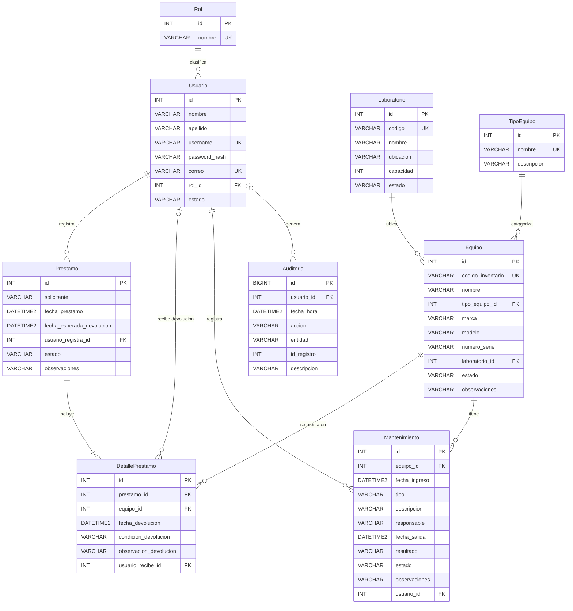

# Modelo entidad-relacion - SIGELAB

Proyecto Final - Curso 017 Programacion II - UMG

Este diagrama coincide con `database/sigelab_schema.sql` (9 tablas). GitHub dibuja el diagrama automaticamente al abrir este archivo.

## Notas del modelo
- Leyenda: PK = llave primaria, FK = llave foranea, UK = valor unico (UNIQUE).
- Prestamo y DetallePrestamo: un prestamo tiene uno o mas equipos (RN-05). La restriccion UNIQUE (prestamo_id, equipo_id) impide repetir un equipo en el mismo prestamo (RN-06).
- La devolucion no es una tabla aparte: se guarda en columnas de DetallePrestamo (fecha_devolucion, condicion_devolucion, observacion_devolucion, usuario_recibe_id). Un equipo pendiente tiene fecha y condicion en NULL; uno devuelto tiene ambas (restriccion CK_Detalle_coherencia).
- Auditoria.usuario_id acepta NULL para registrar logins fallidos de usuarios que no existen. Auditoria.id_registro guarda el id del registro afectado sin llave foranea, porque apunta a distintas tablas segun la entidad.
- Estados controlados con CHECK: Usuario y Laboratorio (ACTIVO, INACTIVO), Equipo (DISPONIBLE, PRESTADO, DANADO, MANTENIMIENTO, BAJA), Prestamo (ACTIVO, FINALIZADO), condicion de devolucion (BUENO, DANADO), Mantenimiento (tipo PREVENTIVO o CORRECTIVO; resultado REPARADO o NO_REPARABLE; estado EN_PROCESO o FINALIZADO).
- Un prestamo vencido no se guarda como estado: se calcula cuando fecha_esperada_devolucion ya paso y existen equipos pendientes (RN-17).
- Los rostros del reconocimiento facial no estan en SQL Server: se guardan como archivos en `facial/rostros/<id de usuario>/`.
